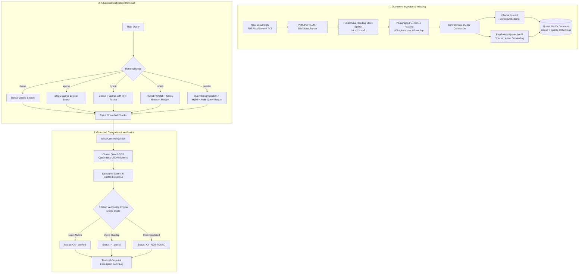

# 🔬 RAG Research Assistant with Citations

[](https://www.python.org/downloads/)
[](https://qdrant.tech/)
[](https://huggingface.co/BAAI/bge-m3)
[](https://huggingface.co/BAAI/bge-reranker-base)
[](https://ollama.com/library/qwen2.5)
[](LICENSE)

An enterprise-grade, fully local **Retrieval-Augmented Generation (RAG) Research Assistant** engineered specifically for academic papers and technical documentation. 

Unlike conventional RAG pipelines that suffer from hallucinations, hand-waving summaries, and untraceable claims, this system enforces **strict sentence-level citation grounding, automated word-for-word quote verification, and honesty-first abstention**, supported by state-of-the-art multi-stage hybrid retrieval (Dense + BM25 Sparse + RRF + Cross-Encoder Reranking + Query Rewriting / HyDE).

---

## 📑 Table of Contents

- [The Core Problem](#-the-core-problem)
- [System Architecture](#-system-architecture)
- [Key Features](#-key-features)
- [Retrieval Strategies](#-retrieval-strategies)
- [Citation Verification Engine](#-citation-verification-engine)
- [Benchmark & Experimental Results](#-benchmark--experimental-results)
- [Project Structure](#-project-structure)
- [Prerequisites & Installation](#-prerequisites--installation)
- [Quickstart Guide](#-quickstart-guide)
- [Usage & CLI Reference](#-usage--cli-reference)
- [Evaluation Suite](#-evaluation-suite)
- [Configuration & Tuning](#-configuration--tuning)
- [License](#-license)

---

## 🎯 The Core Problem

Standard RAG architectures frequently fail in academic and technical domains due to three fundamental flaws:

1. **Hallucinated Citations:** Language models fabricate convincing references and paper names that do not exist in the retrieved corpus.
2. **Ungrounded Claims:** Systems synthesize accurate-sounding prose where factual statements cannot be traced back to a specific sentence or page.
3. **Over-Confident Guessing:** Naive RAG prompts force the model to respond even when the context lacks the answer, generating plausible fiction rather than abstaining.

**This project solves these challenges** through structured schema enforcement, deterministic verification algorithms, and multi-stage hybrid retrieval.

---

## 🏗️ System Architecture



---

## ✨ Key Features

### 1. Structure-Preserving Document Ingestion
- **Heading-Hierarchy Tracking:** Captures nested markdown section paths (e.g., `Document > Method > Attention Mechanism`) and injects breadcrumb metadata into chunk embedding texts.
- **Token-Bounded Packaging:** Enforces clean boundaries (`MAX_TOK=400`, `OVERLAP_TOK=60`, `MIN_TOK=20`) to eliminate truncated thoughts or bloated context windows.
- **Native PDF Ingestion:** Uses `pymupdf4llm` to preserve document layouts, tables, and exact page numbers.
- **Local Embedding Cache:** Employs SHA-1 disk-cached vectors (`data/embed_cache.pkl`) to avoid redundant embedding compute during iterative indexing.

### 2. Dual-Vector Hybrid Search & Reranking
- **Dense Vector Search:** High-dimensional semantic vectors via `bge-m3` capturing conceptual intent.
- **BM25 Sparse Inverted Index:** Inverted index with IDF modifiers via FastEmbed (`Qdrant/bm25`) ensuring exact keyword matches (names, chemical formulas, equations, model parameters).
- **Reciprocal Rank Fusion (RRF):** Seamless server-side fusion inside Qdrant combining rank lists without arbitrary score normalization weights.
- **Cross-Encoder Neural Reranking:** Two-stage scoring with `BAAI/bge-reranker-base` evaluating full query-chunk cross-attention.

### 3. Query Rewriting, Decomposition & HyDE
- **Sub-Query Decomposition:** Parses complex, multi-hop, or multi-part questions into targeted atomic queries.
- **Hypothetical Document Embeddings (HyDE):** Generates candidate technical passages using the LLM to bridge semantic vocabulary gaps between casual queries and formal paper phrasing.
- **Multi-Query Max-Score Reranking:** Aggregates and takes maximum cross-encoder scores across all expanded queries.

### 4. Deterministic Citation Verification & Audit Trails
- **Enforced JSON Schema:** Constrains the LLM output to atomic claims paired with source chunk IDs and direct quotes.
- **Automated Verification Engine:** Validates that every quoted excerpt actually exists in the retrieved chunk text using normalized substring matching and word-overlap ratios.
- **Audit Observability:** Dumps complete interaction logs (timestamp, query, candidate chunks, scores, LLM output, and verification statuses) into `traces.jsonl`.
- **Honest Abstention:** When documents lack necessary evidence, the system explicitly returns `answer_found: false` rather than guessing.

---

## 🔍 Retrieval Strategies

The assistant provides five retrieval backends selectable on the fly:

| Mode | Strategy | Best For | Typical Latency |
| :--- | :--- | :--- | :--- |
| **`dense`** | Semantic cosine similarity on `bge-m3` | Conceptual, exploratory, or paraphrased queries | ~0.34s |
| **`sparse`** | BM25 lexical keyword matching | Exact terms, acronyms, version numbers, entity names | **~0.01s** |
| **`hybrid`** | RRF fusion of Dense + Sparse in Qdrant | Balanced day-to-day search across unknown queries | ~0.11s |
| **`rerank`** | Hybrid prefetch (pool=50) + `bge-reranker-base` | Maximum precision on critical answers | ~20s |
| **`rewrite`** | Multi-query decomposition + HyDE + Cross-Encoder | Complex, multi-part, or vague questions | ~33s |

---

## 🛡️ Citation Verification Engine

Every claim made by the assistant undergoes a strict verification pipeline implemented in `ask.py`:

```python
def check_quote(quote, text):
    """
    Normalizes text (case-folding, alphanumeric filtering) and evaluates:
    - 'verified' (OK)  : Exact normalized substring match within source chunk
    - 'partial'  (~)   : >= 85% word overlap with source chunk
    - 'NOT FOUND'(XX)  : Hallucinated, misattributed, or heavily altered excerpt
    """
```

### Visual Verification Statuses in CLI:
- `OK` **[verified]**: The quote is a 100% faithful, verbatim excerpt from the cited chunk.
- `~ ` **[partial]**: Minor word variation (>= 85% word overlap).
- `XX` **[NOT FOUND]**: The model hallucinated or modified the quote; flagged as untrusted.

---

## 📊 Benchmark & Experimental Results

Evaluated on reproducible test suites (`eval/questions.jsonl` and `evals/questions_papers.jsonl`) measuring **Recall@K (1, 3, 5)**, **Mean Reciprocal Rank (MRR)**, and **Per-Query Latency**:

| Dataset / Experiment | Mode | Test Size ($n$) | Recall@1 | Recall@3 | Recall@5 | MRR | Latency / Query |
| :--- | :--- | :---: | :---: | :---: | :---: | :---: | :---: |
| **Controlled Synthetic Corpus** | `sparse` | 24 | 0.833 | 0.917 | **1.000** | 0.885 | **0.01s** |
| **Controlled Synthetic Corpus** | `dense` | 24 | 0.875 | **1.000** | **1.000** | 0.931 | 0.34s |
| **Controlled Synthetic Corpus** | **`hybrid`** | 24 | **0.917** | 0.958 | **1.000** | **0.948** | **0.11s** |
| **Controlled Synthetic Corpus** | `rewrite` | 28 | 0.857 | 0.964 | **1.000** | 0.920 | 33.07s |
| **Real Research Papers** | `hybrid` | 16 | 0.562 | 0.688 | 0.812 | 0.665 | 0.33s |
| **Real Research Papers** | `rerank` | 16 | 0.188 | 0.625 | 0.812 | 0.418 | 20.39s |

> **Key Takeaway:** Hybrid retrieval (Dense + BM25 RRF) yields the best trade-off between retrieval recall (Recall@5 = 1.0, MRR = 0.948) and sub-second latency (0.11s). For difficult composite queries, `rewrite` expands recall coverage on multi-part questions.

---

## 📁 Project Structure

```plaintext
RAG-Research-Assistant-With-Citations/
├── data/
│   ├── raw/                   # Input markdown, text, or PDF documents
│   ├── chunks.jsonl           # Structured, processed chunk records
│   └── embed_cache.pkl        # Disk cache for embedding vectors (git-ignored)
├── eval/
│   ├── questions.jsonl        # Labeled evaluation questions & ground-truth evidence
│   ├── run.py                 # Benchmarking script computing Recall@K & MRR
│   └── check_labels.py        # Diagnostic script validating ground-truth evidence alignment
├── evals/
│   └── questions_papers.jsonl # Academic paper evaluation benchmark (LoRA, Chinchilla, etc.)
├── add_sparse.py              # Ingests BM25 sparse vectors into Qdrant collection
├── ask.py                     # Main Q&A CLI with citation verification & trace logging
├── compare.py                 # Side-by-side retrieval mode comparison utility
├── gen_eval.py                # End-to-end generation & abstention evaluation script
├── ingest.py                  # Chunking, dense embedding, and Qdrant collection builder
├── make_corpus.py             # Generates synthetic evaluation corpus and questions
├── results.csv                # Benchmark run logs and metrics history
├── retrieve.py                # Retrieval engine (Dense, Sparse, Hybrid, Rerank, HyDE/Rewrite)
├── smoke.py                   # Minimal sanity test for Ollama + Qdrant connectivity
├── requirements.txt           # Python package dependencies
├── .gitignore                 # Cache and artifact exclusion rules
└── README.md                  # Comprehensive documentation
```

---

## 💻 Prerequisites & Installation

### 1. System Requirements
- Python 3.10 or higher
- [Docker](https://www.docker.com/) (recommended for Qdrant) or native binary
- [Ollama](https://ollama.com/)

### 2. Pull Required Ollama Models
Ensure Ollama is running and pull the embedding and chat models:

```bash
# Dense embedding model (multi-lingual, 1024-dim)
ollama pull bge-m3

# Generation & reasoning LLM (7B parameters)
ollama pull qwen2.5:7b
```

### 3. Launch Qdrant Vector Database
Start a local Qdrant instance via Docker:

```bash
docker run -d -p 6333:6333 -p 6334:6334 \
    -v $(pwd)/qdrant_storage:/qdrant/storage:z \
    qdrant/qdrant
```

Verify Qdrant is running at `http://localhost:6333/dashboard`.

### 4. Clone and Install Dependencies

```bash
git clone https://github.com/whysriya0/RAG-Research-Assistant-With-Citations.git
cd RAG-Research-Assistant-With-Citations

# Create and activate a virtual environment
python -m venv .venv
# On Windows:
.venv\Scripts\activate
# On Linux / macOS:
source .venv/bin/activate

# Install required packages
pip install -r requirements.txt
```

---

## 🚀 Quickstart Guide

### Step 1: Run Connectivity Smoke Test
Confirm that your local Ollama and Qdrant instances communicate properly:
```bash
python smoke.py
```

### Step 2: Prepare Documents
You can either place your own `.pdf`, `.md`, or `.txt` files in `data/raw/`, or generate the benchmark corpus:
```bash
python make_corpus.py
```

### Step 3: Ingest and Index Documents
Run the hierarchical chunker and dense vector indexing:
```bash
python ingest.py
```

Generate and attach BM25 sparse vectors for hybrid search:
```bash
python add_sparse.py
```

### Step 4: Ask Questions with Verified Citations
Query the assistant directly via command line:
```bash
python ask.py "Who created the Quill programming language and what are its keywords?"
```

Or enter interactive REPL mode:
```bash
python ask.py
```

---

## 🖥️ Usage & CLI Reference

### 1. Asking Questions (`ask.py`)
Queries the knowledge base, displays structured claims with verified direct quotes, and references source documents.

```bash
python ask.py "How long is the Marlow Bridge?"
```

#### Sample Output:
```text
=== ANSWER (rerank) ===
OK The Marlow Bridge is 412 meters long. [1]
     quote (verified): "is 412 meters long"

=== SOURCES ===
*[1] 0.942 marlow_bridge | The Marlow Bridge > Overview | p.None
 [2] 0.120 marlow_bridge | The Marlow Bridge > History | p.None
 [3] 0.080 skerryball | Skerryball > Overview | p.None
```

### 2. Handling Unanswerable Queries (Abstention)
When asked about facts not present in the ingested corpus:

```bash
python ask.py "What does a wheel of Brindle cheese cost in US dollars?"
```

#### Sample Output:
```text
=== ANSWER (rerank) ===
Not found in the sources.

=== SOURCES ===
 [1] 0.412 brindle_cheese | Brindle Cheese > Aging | p.None
 [2] 0.355 brindle_cheese | Brindle Cheese > What it is | p.None
```

### 3. Comparing Retrieval Modes (`compare.py`)
Compare top results across all 4 core retrieval modes (`dense`, `sparse`, `hybrid`, `rerank`) for a given query:

```bash
python compare.py "Which keyword declares a variable in Quill?"
```

#### Sample Output:
```text
===== dense =====
1. 0.812 quill_language | The Quill Programming Language > Design goals | 'Marchetti wanted beginners to read code almost like plain English. For that reason...'

===== sparse =====
1. 14.281 quill_language | The Quill Programming Language > Design goals | 'Marchetti wanted beginners to read code almost like plain English. Variables are declared with the keyword "hold"...'

===== hybrid =====
1. 0.032 quill_language | The Quill Programming Language > Design goals | 'Marchetti wanted beginners to read code almost like plain English...'

===== rerank =====
1. 0.967 quill_language | The Quill Programming Language > Design goals | 'Variables are declared with the keyword "hold". Error messages are written as full sentences...'
```

---

## 🧪 Evaluation Suite

The repository includes a comprehensive, rigorous evaluation framework to prevent regressions and benchmark new models:

### 1. Validate Evidence Labels
Ensures ground-truth answers in the test dataset still exist verbatim in `data/chunks.jsonl`:
```bash
python eval/check_labels.py
```

### 2. Run Retrieval Benchmarks
Evaluates Recall@1, Recall@3, Recall@5, MRR, and per-query latency across specified modes and appends results to `results.csv`:

```bash
# Evaluate all modes
python eval/run.py

# Evaluate specific modes with an experiment tag
python eval/run.py hybrid,rerank "experiment_chunk400"
```

### 3. Run End-to-End Generation & Citation Evaluation
Evaluates whether answerable questions are answered, unanswerable questions are correctly abstained from, and quotes are verified:

```bash
python gen_eval.py
```

---

## ⚙️ Configuration & Tuning

Key hyperparameters can be adjusted across configuration variables:

| File | Variable | Default | Description |
| :--- | :--- | :--- | :--- |
| `ingest.py` | `MAX_TOK` | `400` | Maximum token cap per text chunk |
| `ingest.py` | `OVERLAP_TOK` | `60` | Number of tokens carried forward across chunks |
| `ingest.py` | `EMBED_MODEL` | `"bge-m3"` | Ollama model identifier for dense embeddings |
| `retrieve.py`| `LLM` | `"qwen2.5:7b"` | Model used for query rewriting & HyDE |
| `retrieve.py`| `pool` | `50` | Candidate prefetch pool size prior to reranking |
| `ask.py` | `MODE` | `"rerank"` | Default retrieval pipeline (`dense`, `sparse`, `hybrid`, `rerank`, `rewrite`) |
| `ask.py` | `K` | `6` | Number of source chunks injected into context window |

---

## 📜 License

This project is licensed under the **MIT License**. You are free to use, modify, and distribute it for research, academic, or commercial applications.